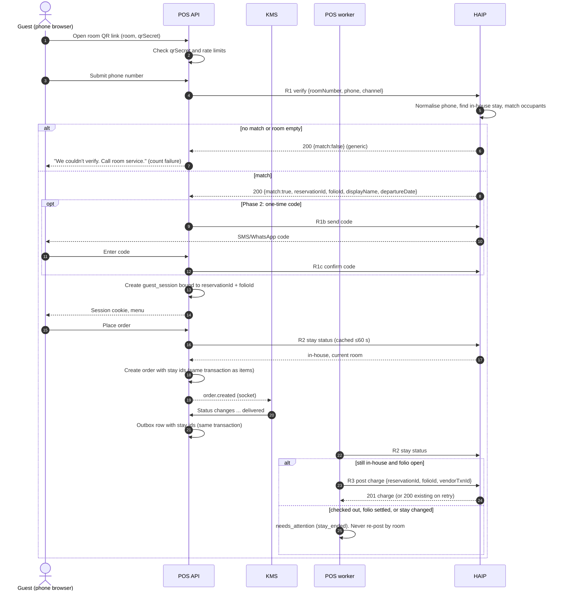

# POS/KMS ↔ HAIP integration design: verify the guest, bind the order to the stay

Draft for review, 2026-11-12. Research only: no code, database or container was changed.

**Update 2026-11-22, HAIP `439956d`:** re-checked after the update from `83f88e5` (8 commits, migration 0033). None of R1–R8 is delivered, and every module this design depends on is unchanged. A new property-wide charge ledger (`GET /folios/charges`) partly helps reconciliation (Q5/R5); Q6 is unchanged. `folio.service.ts` and `folio.controller.ts` citations below are updated to their new line numbers. Details in `AUDIT.md` §14.

- **HAIP read at `83f88e5`** (2026-11-10), clean tree, 41 commits after `928c2f6`. None of the modules this design depends on changed since `928c2f6`: folio-inbound, pos, reservation, room, connect, webhook, guest-check-in, folio and Keycloak (`git diff --stat 928c2f6..83f88e5` on those paths is empty).
- **POS read at `main` `e2e87fc`.**
- **Baseline:** `AUDIT.md`, especially §5, §6, §8, §9 (live runs), §10 and §11.

**How to read the citations**

| Prefix | Means |
|---|---|
| `H/` | `haip/apps/api/src/modules/` |
| `HDB/` | `haip/packages/database/src/` |
| `Hdocs/` | `haip/docs/integrations/` |
| `P/` | `pos/apps/api/src/` |
| `PDB/` | `pos/packages/database/src/` |

Anything not read directly in code is marked **(inferred)**.

---

## Summary

- **The wrong-guest problem has a fix that needs no new HAIP code:** post to the guest's **folio id**, not the room number.
  - HAIP refuses to post to a folio that isn't `open` (`H/folio/folio.service.ts:728-729`).
  - Checkout settles every open folio (`H/reservation/reservation.service.ts:856-860`).
  - So a late charge can at worst be rejected. It can never land on the next guest.
  - The folio also stays with the reservation through a room move, so the charge follows the guest.
- **POS can already find a room's in-house stay and read guest phones**, but only with a **service principal** (Keycloak client-credentials JWT), not with the POS API key. It takes several calls, and guest phone numbers would pass through POS.
- **No HAIP endpoint verifies "room + phone"** or returns a stay without exposing personal data. A small new HAIP endpoint is the clean way: the phone stays in HAIP, and POS gets back only stay ids.
- **HAIP already has a pattern to copy:** online check-in issues stay-bound, HMAC-signed guest tokens, with a rate-limited, no-enumeration "request link" route (`H/guest-check-in/`).
- **Recommendation: "verify once, bind to stay".**
  1. The guest scans a room QR and enters their phone, or staff enter it for them.
  2. HAIP checks it and returns `reservationId` + `folioId`.
  3. POS creates a guest session bound to that stay. Every order carries the stay ids.
  4. The worker re-checks the stay and posts to that folio, idempotently.
- **A phone number isn't a secret.** For self-ordering in production, add a one-time code sent by HAIP, or a per-room QR secret, on top of room + phone.

---

## 1. What exists in HAIP today that POS can use

### 1.1 Ways to authenticate

| Method | How it works | What it can reach | Evidence |
|---|---|---|---|
| **Connect API key** (`x-api-key`), property-scoped | SHA-256 hash looked up in `connect_credentials`; locked to one property; revocable | Connect routes, `folio-inbound`, `pos/charges`, webhook subscriptions | `H/auth/api-key.guard.ts:24,31-38,91-104`; `H/auth/connect-scope.guard.ts:54-80`; `Hdocs/connect-api-key.md:13-20` |
| **Service principal** (client-credentials JWT from Keycloak, or any OIDC provider since `846558d`) | Confidential client; `aud`, `azp` allow-list and `property_ids` claim; linked to a local user with `pnpm integration:link` | All staff REST routes, limited by permissions | `Hdocs/service-principal.md:9-23,74-80`; `H/auth/oidc-config.ts:39-76`; `H/auth/jwt.strategy.ts:37-44`; `Hdocs/oidc-generic.md:14-34` |
| **Check-in magic token** (guest) | HMAC over `{reservationId, propertyId, exp}`; 48 h default, staff can give up to 7 days | Only `/guest-check-in/*` routes | `H/guest-check-in/check-in-token.ts:3-9,21-25,59-67`; `H/guest-check-in/check-in-magic.guard.ts:17-45` |

**Notes**
- **Read routes need only a valid JWT and property scope.** The global guards are JWT, Roles, PropertyScope and Permissions (`H/auth/auth.module.ts:61-64`), and the Permissions guard allows any route without `@RequirePermissions` (`H/auth/permissions.guard.ts:41-42`). The guest, reservation and room reads have no such decorator (`H/guest/guest.controller.ts:32-63`, `H/reservation/reservation.controller.ts:142,177,267`, `H/room/room.controller.ts:208,228`).
- **Consequence:** any linked principal for the property, even an `inventory` one, can read guest phones. That's a HAIP-side gap to raise (§7, N9).
- **Auth off means no checks at all.** With `AUTH_ENABLED=false`, the permission and property checks are skipped (`H/auth/permissions.guard.ts:33`, `H/auth/property-scope.guard.ts:53`), and folio-inbound refuses to work (`AUDIT.md` §6).
- **API keys have no per-route scopes.** A property key can call every Connect-guarded route for its property (`H/auth/connect-scope.guard.ts:54-80`).
- **Reversal is possible today.** A custom service principal may be granted `folios.manage` (`HDB/integration-principal.ts:43-48`), which allows posting to and reversing any folio at the property (`H/folio/folio.controller.ts:157-158,178-179`). That's broad.

### 1.2 Endpoints relevant to this flow

| Need | Endpoint | Auth | What it gives | Evidence |
|---|---|---|---|---|
| Post a charge by room | `POST /folio-inbound/charges` | API key | Room → in-house reservation (`checked_in`, `stayover`, `due_out`) → `guest` folio, decided when the charge arrives. A duplicate `vendorTxnId` still gives **500** (§9 S2a; code unchanged) | `H/folio-inbound/folio-inbound.service.ts:19,29,43,64,69,80` |
| Post a charge by folio | `POST /pos/charges` | API key | Posts to a given `folioId`. **No idempotency**: `reference` only goes into the description. **Does** emit `folio.charge_posted` | `H/pos/dto/post-pos-charge.dto.ts:41-43,70-73`; `H/pos/pos.service.ts:19-31`; `H/folio/folio.service.ts:821-827` |
| Closed-folio rule | Inside every post | n/a | Refuses a folio that isn't `open` | `H/folio/folio.service.ts:728-729`; statuses `HDB/schema/folio.ts:18-22` |
| List in-house reservations | `GET /reservations?statuses=checked_in,stayover,due_out` | JWT | Paged (max 100). Returns `roomId`, `roomNumber`, `guestId`, guest name and VIP level, **no phone**. **No room filter** | `H/reservation/dto/list-reservations.dto.ts:24-58,74-77`; `H/reservation/reservation.service.ts:1317-1395` |
| Occupants of a reservation | `GET /reservations/:id/guests` | JWT | Primary and accompanying guests: name and email, **no phone** | `H/reservation/reservation-party.service.ts:578-623` |
| Guest record | `GET /guests/:id` | JWT | Full row **including phone** | `H/guest/guest.service.ts:81-96` |
| Guest search | `GET /guests?search=` | JWT | Partial match on name, email, **phone**, tax id and ID number, across all guests with any reservation at the property | `H/guest/guest.service.ts:280-320` (phone `:312`) |
| Guest stay history (new) | `GET /guests/:id/stays` | JWT | Stays with status and room number | `H/guest/guest.controller.ts:42-52`; `H/guest/guest.service.ts:99` (starts there) |
| Folios of a reservation | `GET /folios?reservationId=&status=` | JWT + `folios.read` | Folio ids and status | `H/folio/folio.controller.ts:94-106`; `H/folio/dto/list-folios.dto.ts:13,28` |
| Property-wide charge ledger (new in `439956d`) | `GET /folios/charges?propertyId=&type=food_beverage&from=&to=&folioId=` | JWT + `folios.read` | All charges at the property, 100 per page max, with folio number, description, amounts and reversal flags. **No `vendorTxnId` or text filter**, and no link to `folio_inbound_posts`. `byCurrency` totals cover the returned page only | `H/folio/folio.controller.ts:58-71`; `H/folio/dto/list-property-charges.dto.ts:34-81`; `H/folio/folio.service.ts:1129-1228` |
| Reverse a charge | `POST /folios/:id/charges/:chargeId/reverse` | JWT + `folios.manage` | Reversal | `H/folio/folio.controller.ts:178-179` |
| Property currency and timezone | `GET /connect/properties/:id` | API key | `currencyCode`, `timezone` | `H/connect/connect.controller.ts:83-95`; verified live in §9 |
| Webhooks | `POST /connect/subscriptions`; poll `GET /connect/events` | API key | HMAC-signed (`X-HAIP-Signature: sha256=…`, plus event id and type headers) | `H/webhook/webhook-delivery.service.ts:219-241`; `H/connect/connect.controller.ts:213` |
| Guest check-in session | `GET /guest-check-in/session` | Check-in token | Reservation id, status, departure, **room number**, guest email and **phone**, folio balance | `H/guest-check-in/guest-check-in.service.ts:273-317` |

### 1.3 Events POS could subscribe to

| Event | Payload today | Missing for POS | Evidence |
|---|---|---|---|
| `reservation.checked_in` | `{ roomId, folioId, isEarlyCheckin }` (reservation id is the entity id) | room **number** | `H/reservation/reservation.service.ts:720-726` |
| Self check-in by phone | Same event: it calls the same `checkIn` | none | `H/guest-check-in/guest-check-in.service.ts:905` |
| `reservation.room_moved` | `{ reservationId, previousRoomId, newRoomId, reason, status }` | room numbers | `H/reservation/reservation.service.ts:364-376` |
| `reservation.checked_out` | `{ isLateCheckout, expressCheckout }` | room and folio ids | `H/reservation/reservation.service.ts:895-901` |
| `reservation.cancelled`, `.no_show`, `.modified` | dates and room type | n/a | `H/reservation/reservation.service.ts:430-443,465-475,1210-1222` |
| `reservation.guest_added`, `.guest_removed`, `.guest_moved` | occupant changes | n/a | `H/reservation/reservation-party.service.ts:142,181,510` |
| `folio.charge_posted` | `{ folioId, type, amount, description }` | `vendorTxnId`; **not emitted for folio-inbound**, which posts inside a transaction | `H/folio/folio.service.ts:821-827` |

### 1.4 Direct answer: can POS find the stay, read the phone, or verify room + phone today?

| Question | API key | Service principal (JWT) | Staff JWT |
|---|---|---|---|
| Find the in-house stay for a room | **No.** Folio-inbound does this internally at post time only | **Yes, indirectly:** list in-house reservations (max 100 per page) and filter by `roomNumber` in POS | Same as service principal |
| Read a guest's phone | No | **Yes:** `GET /guests/:id` for each occupant id | Yes |
| Verify room + phone in one call, without seeing the phone | **No** | **No.** POS would have to fetch phones and compare them itself | No |
| Get the stay's folio id | Only from the `checked_in` webhook | `GET /folios?reservationId=` with `folios.read` | Yes |

**Bottom line**
- Verification is technically possible today with a service principal and about four calls: list reservations, list occupants, get each guest, get folios.
- But it copies guest phone numbers into POS, needs a principal that can read every guest, and pages through all in-house reservations on each check.
- Use it only for a demo adapter, not production (option d1 in §3).

---

## 2. How HAIP stores guest phone numbers

| Topic | Finding | Evidence |
|---|---|---|
| Field | `guests.phone`, `varchar(30)`, nullable, one per guest | `HDB/schema/guest.ts:20` |
| Validation on input | `@IsString() @MaxLength(30)` only. **No format, no E.164, no normalisation** | `H/guest/dto/create-guest.dto.ts:34-37` |
| Online check-in | The guest can overwrite it with free text | `H/guest-check-in/guest-check-in.service.ts:520-521` |
| Index | None on phone. Search is `ILIKE '%…%'` | `H/guest/guest.service.ts:312` |
| E.164 anywhere? | Only the SMS and WhatsApp send DTOs expect E.164 | `H/notifications/dto/send-sms.dto.ts:10` |
| Guests per reservation | `reservation_guests` with role `primary` or `accompanying`; each is a separate `guests` row with its own phone | `HDB/schema/reservation.ts:200-214` |
| Sharers | Several accompanying guests per reservation. A guest can't be on two rooms of the same booking | `H/reservation/reservation-party.service.ts:635-653` |
| Uniqueness | None. Many guests can share a phone, and many have none **(inferred from the nullable column and lack of a unique index)** | `HDB/schema/guest.ts:20` |

**Normalisation needed (HAIP side, so the phone never leaves HAIP)**
1. Strip spaces, dashes, dots and brackets; keep a leading `+`.
2. Convert `00` to `+`.
3. With no country code, apply the **property's country** default (`+91` for India), and drop one leading trunk `0` (common in India and the UK).
4. Compare **E.164 to E.164**. If the stored value can't be normalised, treat it as no match and log a data-quality warning.
5. Optional softer rule: match the last 10 digits when both numbers have at least 10. This handles "98xxxxxx10" against "+91 98xxxxxx10", at a slightly higher false-match risk.
6. Better long term: HAIP stores a normalised `phone_e164` column, validated with `libphonenumber`. That's a new HAIP migration, which is their call.

---

## 3. Options for room + phone verification

| | a) Live lookup per order or session | b) POS stay cache fed by webhooks | c) Stay token from HAIP at check-in | d1) Existing staff REST (service principal) | d2) Reuse the check-in magic token |
|---|---|---|---|---|---|
| **How it works** | POS sends room + phone to a new HAIP endpoint; HAIP answers match/no-match plus stay ids | POS keeps room → reservation/folio from `checked_in`, `room_moved` and `checked_out` events; phone still checked by HAIP | HAIP issues a signed stay token (QR or link) in the welcome message or on the key card; POS has HAIP check it | POS lists in-house reservations, filters by room, reads occupants' phones and compares | Guest opens POS from the check-in link; POS calls `GET /guest-check-in/session` with the token |
| **New HAIP work** | 1 endpoint (R1), plus a stay-status endpoint (R2) | Webhook payload additions (R6); phone still needs R1 | Token issue + introspection endpoint + delivery | **None** | **None** to try; for production, a token scoped to ordering with revocation |
| **Security** | Good with HAIP-side rate limits. Phone knowledge is weak, so add a one-time code for self-ordering | Cache can go stale; a missed event means wrong data | Strong: possession of a token sent only to the guest | Broad: the principal can read **all** guests | Token can be forwarded; lasts up to 7 days; **not revoked at checkout** (`check-in-magic.guard.ts:17-29` checks only the signature) |
| **Privacy (DPDP)** | Phone stays in HAIP; POS sees ids and a display name | Same as (a) if phone stays in HAIP | Best: no phone typed at all | **Phone numbers copied into POS memory**; broad PII access | Session returns phone and email to POS (`guest-check-in.service.ts:296-297`) |
| **HAIP down** | No new verifications; existing sessions keep ordering, posts queue | Works from cache (risky) | Tokens can't be checked unless POS caches results | No verifications | No verifications |
| **Checkout race** | Re-check before posting; folio closed means rejected, never wrong guest | Depends on event timing | Introspection shows status | Same as (a) | Session shows status |
| **Room move** | Session bound to reservation, so it follows | Needs `room_moved` with numbers | Token bound to reservation, so it follows | Follows if bound to folio | Follows |
| **Re-let** | New guest's phone won't match the old stay | Risk if the checkout event was missed | Old token fails once status is checked out | Same as (a) | Old token stays valid up to its expiry; POS must check status |
| **Online check-in** | Works once status is in-house | Works | Token issued at self check-in | Works | Natural fit |
| **Effort (rough)** | HAIP S–M; POS M | HAIP S; POS M; ops M (subscriptions, replay) | HAIP M–L; POS M | POS S–M | POS S; HAIP M for production |
| **Verdict** | **Core of the recommendation** | Useful **extra** for room changes and session revocation, not as the source of truth | **Phase 3 enhancement**: "Order food" button in the welcome message | **Demo adapter only** | Not as it is; good model for (c) |

**Rejected:** POS holding guest phones (from b or d1) as its own copy. That breaks the spec rule that guests and stays are owned by HAIP (`AUDIT.md` §3), and puts POS in scope for DPDP storage duties.

---

## 4. Recommended design: verify once, bind to stay

### 4.1 Principles

1. **HAIP decides who is staying.** POS never stores a phone number.
2. **Verification returns stay ids.** POS keeps `reservationId` and `folioId`, never the phone.
3. **Every order carries the stay ids.** Room number is only for delivery and display.
4. **Posting goes to the stored folio**, after a fresh check that the stay is still in-house. Never re-route by room number.
5. **Fail closed.** No match, HAIP down or an ambiguous room means no self-order. Staff can still take the order, but it's marked unverified and its charge is held.

### 4.2 Guest self-ordering (room QR)

1. A QR sticker in each room opens `https://<pos>/order?p=<propertyId>&r=<roomNumber>&q=<roomQrSecret>`. The `q` secret proves the scan came from that room's sticker, and stickers are rotated when lost.
2. POS checks `q` against `room_qr_codes`. If wrong or expired, it shows "Please call room service".
3. The guest enters their mobile number, with the country code defaulting to the property's country.
4. POS checks its own rate limits (§4.6), then calls **HAIP R1** with room, phone and `channel: guest_self`.
5. HAIP normalises the phone and finds the in-house reservation for that room. It matches the phone against **all occupants** (primary and accompanying).
6. **No match:** HAIP returns a generic "no match", with no hint whether the room is empty or the phone is wrong. POS counts the failure.
7. **Match:** HAIP returns `reservationId`, `folioId`, `guestDisplayName` (for example "Ada L."), `departureDate`, current `roomNumber` and `currencyCode`.
8. **Phase 2, recommended for production:** HAIP sends a 6-digit code to that phone by SMS or WhatsApp (R1b). The guest enters it (R1c) before the session starts.
9. POS creates a `guest_sessions` row and sets an opaque session token in an httpOnly, Secure, SameSite=Strict cookie. The session expires at the earlier of checkout time on `departureDate` or 24 hours, and is renewable.
10. The guest browses the menu and orders. POS creates the order with `haip_reservation_id`, `haip_folio_id` and `guest_session_id`, all copied from the session.
11. Before accepting each order, POS calls **R2** (stay status), or trusts a cached result under 60 seconds old. If the stay isn't in-house, POS revokes the session and refuses the order. The delivery room comes from R2, so it's right after a room move.
12. Kitchen flow is unchanged. On delivery, the outbox row copies the stay ids.

### 4.3 Staff ordering on behalf of a guest

1. A staff member signs in to POS (`AUDIT.md` task 3; their identity is recorded).
2. They enter room + guest phone, as the guest says it, or read it off a key-card folder.
3. POS calls **R1** with `channel: staff` and the staff member's id. HAIP applies the same rules; there's no one-time code, because the staff member is the check.
4. **Match:** as in self-ordering, the order is bound to the stay.
5. **No phone on file, or a sharer without one:** staff choose **"verify by name"**. R1 with `method: staff_attested` returns occupant display names for that room, with no phones. Staff pick one, and the order is bound to that stay with `verified_by_staff_id`. Whether restaurant staff may see occupant names is a decision (§7, N5).
6. **Stay lookup down, or HAIP not configured (decided 2026-11-22):** staff can still save the order.
   - POS shows a clear **"Unverified"** warning that staff must confirm before placing the order.
   - The order is saved with `verification_status = 'unverified'` and no stay ids. The kitchen cooks it as normal.
   - At posting time, the worker tries to verify again. If there is **exactly one** in-house stay in that room, it attaches that stay's ids and posts (§4.8).
   - Otherwise (no stay, more than one, or the lookup still down), it parks the row as `needs_verification` **without sending**. A manager binds it to a stay; it's never posted by room number alone.

### 4.4 Sequence



### 4.5 POS data model changes

All new columns are nullable, so existing rows keep working. One migration in `PDB/`.

**Phase 1 scope (decided 2026-11-22):** only the `orders` and `haip_post_outbox` changes, plus `verified_guest_name` and `verified_at` on `orders`. `guest_sessions`, `verification_attempts` and `room_qr_codes` are deferred to guest self-ordering (Phase 2). `post_mode` isn't needed in Phase 1, because every post still goes through folio-inbound.

| Table | Change | Notes |
|---|---|---|
| `guest_sessions` (new) | `id`, `property_id`, `token_hash` (SHA-256 of a 32-byte random token), `haip_reservation_id`, `haip_folio_id`, `room_number_at_verify`, `guest_display_name`, `channel` (`guest_qr` or `staff`), `verification_method` (`phone`, `phone_otp` or `staff_attested`), `verified_by_staff_id` (nullable), `verified_at`, `expires_at`, `revoked_at`, `revoke_reason`, `last_seen_at`, `created_at` | **No phone column.** Unique index on `token_hash`; index on `(property_id, haip_reservation_id)` for revoking on events |
| `verification_attempts` (new) | `id`, `property_id`, `room_number`, `client_key_hash` (hashed IP plus device cookie), `channel`, `outcome` (`match`, `no_match`, `rate_limited`, `error`), `created_at` | For rate limits and audit. **No phone, not even hashed**: a phone hash is easy to brute-force. Keep 30 days |
| `room_qr_codes` (new) | `property_id`, `room_number`, `secret_hash`, `created_at`, `rotated_at` | One active secret per room |
| `orders` | add `haip_reservation_id`, `haip_folio_id`, `guest_session_id` (foreign key), `ordered_via` (`staff` or `guest`), `verification_status` (`verified` or `unverified`) | `room_number` stays as the delivery room (`PDB/schema/orders.ts:19`) |
| `haip_post_outbox` | add `haip_reservation_id`, `haip_folio_id`, `post_mode` (`room` for legacy, `folio`), `parked_reason` enum (`stay_ended`, `folio_not_open`, `needs_verification`, `wrong_property`, `haip_rejected`) | `parked_reason` replaces the text match in `P/haip/no-in-house-guard.ts` (`AUDIT.md` §9 follow-up) |

### 4.6 Authentication

| Who → whom | Recommendation | Why |
|---|---|---|
| POS → HAIP for verify, status and posting | **Property-scoped API key**, plus the new narrow routes R1–R5 under the API key surface | Same credential POS already uses; tenant-locked; revocable; doesn't depend on Keycloak (`H/auth/api-key.guard.ts:91-104`) |
| POS → HAIP fallback, if HAIP prefers JWT | Service principal with a new **narrow** permission (for example `pos.stay_verify`) on the same routes | The existing `integration_reservations` profile can read every guest (`HDB/integration-principal.ts:33-37`), which is too broad |
| Guest → POS | Opaque session token in an httpOnly cookie, stored hashed, bound to one stay; refreshed by R2 checks | No guest accounts needed; easy to revoke |
| Staff → POS | HAIP Keycloak/OIDC login (`AUDIT.md` task 3), with POS client roles. **Designed in §8** | Staff identity recorded on staff-verified orders |
| KMS socket | Staff JWT on the handshake, verified the way HAIP's `WsAuthService` does it (JWKS, issuer, audience, `azp`) | Pattern in `H/auth/ws-auth.service.ts:41-74`; the POS gateway has no auth today (`P/events/kitchen.gateway.ts:32-42`) |

### 4.7 Rate limiting and brute-force protection

**Why it matters:** a 10-digit mobile number can't be guessed quickly, but phone numbers aren't secret. A guest's companion, a previous guest or a scraped list may know them. So limits slow guessing, and the one-time code covers "knows the number".

| Layer | Rule (suggested defaults) |
|---|---|
| Room QR secret | Without the right `q`, POS never calls HAIP. Rotate it when a sticker is lost |
| Per room | 5 failed attempts in 15 minutes locks self-verification for that room for 15 minutes, and alerts staff on the POS screen |
| Per device/IP | 10 attempts per hour |
| Per property | Alert at more than 50 failures per hour (possible scripted attack) |
| HAIP side (defence in depth) | R1 applies its own per-room and per-key limits, like the check-in throttle guard (`H/guest-check-in/check-in-throttle.guard.ts:10-55`). That guard keeps counts in memory per process, so with several API replicas it should use Redis **(inferred: in-memory `Map`, `:19`)** |
| Responses | Always generic: never say "room is empty" or "phone is wrong", following `requestLink` (`H/guest-check-in/guest-check-in.service.ts:634-700`) |
| One-time code (Phase 2) | 6 digits, 5 minutes, 3 tries, then a new code is needed; at most 3 codes per room per hour |
| Logging | Log outcomes, never phone numbers (POS already redacts keys, `P/haip/haip-client.ts`) |

### 4.8 How posting changes

| Step | Today | New |
|---|---|---|
| What is sent | Room number (`P/haip/charge-mapper.ts:28-29`; `H/folio-inbound/folio-inbound.service.ts:52-80`) | `reservationId` + `folioId` + `vendorTxnId` (R3) |
| Check before posting | None; HAIP looks up the room when the charge arrives | Worker calls R2. Not in-house or folio not open means `needs_attention` with `parked_reason`. Never fall back to room |
| Duplicates | `vendorTxnId` unique in HAIP; a repeat gives **500** (§9 S2a) | R3 returns the existing charge (200) for a repeat |
| Wrong guest | Possible on late posts (§9 S6c) | Impossible: the folio belongs to one reservation, and HAIP refuses non-open folios (`H/folio/folio.service.ts:728-729`) |
| Legacy rows | n/a | Rows with no stay ids keep `post_mode='room'` and the current guard |

**Interim until HAIP ships R3 (decided 2026-11-22): keep folio-inbound, with a stay re-check before every attempt.**

Before each post attempt, including retries, the worker asks the `StayLookup`:

| Re-check result | Action |
|---|---|
| Stored stay is in-house, and it's the **only** in-house stay in its current room | Post through `POST /folio-inbound/charges` with the same `vendorTxnId` and the stay's **current** room number. A room move is followed |
| Stay ended, or not found | Park as `stay_ended` **without sending** |
| More than one in-house stay in that room | Park as `needs_verification` **without sending**. Folio-inbound would pick one of them arbitrarily (`H/folio-inbound/folio-inbound.service.ts:56-66`) |
| Lookup unavailable | Retry later; nothing is sent |
| Order is `unverified` (no stay ids) | Same check by room: exactly one in-house stay means attach its ids and post; otherwise park as `needs_verification` (§4.3 step 6) |

**Why not `POST /pos/charges` to the stored folio yet:**
- It has **no idempotency**. `reference` only goes into the description (`H/pos/pos.service.ts:19-31`). `postCharge` is a plain insert (`H/folio/folio.service.ts:713-746`).
- The `charges` table's unique `(property, folio, source_key)` index isn't reachable from the POS DTO (`HDB/schema/folio.ts:116,130-131`).
- So a retry after a lost response would double-charge.

| | `/pos/charges` + retry only when never sent | **folio-inbound + re-check (chosen)** |
|---|---|---|
| Double charge | Possible if a failure is misclassified; every timeout or 5xx needs a person | Impossible: unique `vendorTxnId` |
| Wrong guest | Impossible: closed folios are refused | Only if the stay ends **and** the room is re-let between the re-check and HAIP's lookup (milliseconds). Two stays in one room are parked, not posted |

**Remaining risk:** the re-check-to-post window above. It's closed when HAIP ships R3, after which POS posts by `reservationId` + `folioId`.

**Suggestion for HAIP:** expose `source_key` on `/pos/charges`, or pass `vendorTxnId` into it. The unique index already exists, so R3 could be small.

### 4.9 Checkout, room moves, cancellations and refunds

| Situation | Handling |
|---|---|
| **Checkout, no pending charges** | `reservation.checked_out` webhook, or a later R2 check, revokes the stay's guest sessions. New orders are refused |
| **Checkout with a POS charge still pending** | HAIP requires zero balance at checkout (`H/reservation/reservation.service.ts:787-795`) and settles the folio (`:856-860`). A later post is rejected (folio not open) and parks as `stay_ended`. **Never charged to the next guest.** To avoid lost revenue, HAIP should warn the front desk first (R7; decision §7 Q8) |
| **Folio settled mid-stay** | HAIP has no reopen. A folio can only close after settling (`H/folio/folio.service.ts:199-203`), and no reopen exists in `H/folio/` **(inferred from search)**. Charges park as `folio_not_open`; R2 could return the reservation's current open guest folio, and the worker posts there only if it belongs to the **same** reservation |
| **Room move** | Session and orders are bound to the reservation, so the charge follows the guest (fixes §9 S5). The delivery room comes from R2 or `room_moved`, and KMS shows it |
| **Re-let to a new guest** | Old sessions were revoked at checkout. The new guest must verify with their own phone. Old orders post to the old folio, which is rejected if closed |
| **Online check-in** | Self check-in fires the same `checked_in` event (`H/guest-check-in/guest-check-in.service.ts:905`). Verification works as soon as the status is in-house; before that, R1 returns no match |
| **Two in-house reservations in one room** (rare, for example day-use) | R1 matches by phone, so the right one is chosen. Folio-inbound today takes the first row (`H/folio-inbound/folio-inbound.service.ts:56-66`) **(inferred risk)** |
| **Cancel before delivery** | Unchanged: no charge (`AUDIT.md` §5.3) |
| **Void or refund after delivery** | New POS `void` action for managers creates an outbox `reverse` job → R4 reverses by `vendorTxnId`. If the folio is already settled, it becomes a front-desk refund or adjustment in HAIP (policy decision, §7 Q4) |

---

## 5. What POS can build now, and what waits for HAIP

### 5.1 Buildable now, behind a `HaipStayDirectory` interface with a fake HAIP

| Item | Notes |
|---|---|
| `HaipStayDirectory` interface (`verify`, `stayStatus`, `postCharge`, `reverseCharge`) with three adapters: **Fake** (tests and demo), **StaffRest** (d1, demo only, service principal), **Native** (R1–R5, once HAIP ships them) | Keeps HAIP specifics out of the order flow |
| Migration from §4.5 | All nullable; safe on existing data |
| Guest ordering web app (QR landing, phone entry, menu, order status) | Uses `packages/ui` |
| Session handling, cookies, expiry, revoke on events | Needs only the interface |
| Rate limits and `verification_attempts` | POS-side layer |
| Room QR generation and rotation (admin screen) | |
| Orders carry stay ids; outbox copies them; `parked_reason` column replaces the text-match guard | Fixes the guard's fail-open problem (`AUDIT.md` §9) |
| Worker: re-check before posting; post to folio through the interface; legacy `room` mode for old rows | |
| Interim posting through folio-inbound, with a stay re-check and a one-stay-per-room check before every attempt (§4.8) | Real HAIP, no new endpoint; keeps duplicate protection and closes most of the wrong-guest risk |
| Webhook receiver (signature check, `X-HAIP-Event-Id` dedupe) for `checked_in`, `room_moved`, `checked_out` | Works with today's payloads; maps `roomId` with the stay data |
| Contract tests: the Fake adapter must match the specs in §5.2 | So switching adapters is low-risk |

### 5.2 Requests for HAIP (exact specs)

All requests below are under the API key surface (`ApiKeyGuard` + `ConnectScopeGuard`, property-scoped key only), next to folio-inbound. The paths are suggestions.

**R1 — Verify a guest's stay by room + phone**
- `POST /api/v1/folio-inbound/stays/verify`
- Request:
  ```json
  { "roomNumber": "1204", "phone": "+91 98765 43210", "channel": "guest_self", "method": "phone", "clientRef": "pos-session-attempt-uuid" }
  ```
  `channel` is `guest_self` or `staff`. `method` is `phone` or `staff_attested` (with `staff_attested`, `phone` may be left out and `staffRef` is required).
- `200` match:
  ```json
  { "match": true, "reservationId": "uuid", "folioId": "uuid", "guestDisplayName": "Ada L.", "roomNumber": "1204", "departureDate": "2026-11-14", "currencyCode": "INR", "verificationId": "uuid" }
  ```
- `200` no match: `{ "match": false }`. The same reply for an empty room, a wrong phone or no phone on file.
- `staff_attested` returns `{ "match": true, "occupants": [{ "occupantRef": "opaque", "displayName": "Ada L." }] }`; a second call with `occupantRef` binds one.
- Errors:
  - `400` validation
  - `401` / `403` key or scope
  - `409 AMBIGUOUS_STAY` (two in-house stays and phone doesn't narrow it down)
  - `429` with `Retry-After`
- Rules:
  - Phone normalised to E.164 using the property's country (§2).
  - Matches primary **and** accompanying occupants.
  - Statuses `checked_in`, `stayover` and `due_out` only.
  - **Never returns a phone or email.**
  - Rate-limited per room and per key.
  - Every attempt audit-logged.

**R1b / R1c — One-time code (Phase 2)**
- `POST /api/v1/folio-inbound/stays/verify/{verificationId}/otp`: HAIP sends a code to the matched phone through its SMS or WhatsApp provider. Returns `202 { "expiresAt": "…" }`.
- `POST /api/v1/folio-inbound/stays/verify/{verificationId}/otp/confirm` with `{ "code": "123456" }`:
  - `200 { "confirmed": true }`
  - `400 INVALID_CODE` (with tries left)
  - `410 EXPIRED`
  - `429`

**R2 — Stay status**
- `GET /api/v1/folio-inbound/stays/{reservationId}`
- `200`:
  ```json
  { "reservationId": "uuid", "status": "checked_in", "inHouse": true, "roomNumber": "1206", "departureDate": "2026-11-14", "guestFolioId": "uuid", "guestFolioStatus": "open" }
  ```
- `404`: not found at this property.

**R3 — Post a charge to a specific stay (extend folio-inbound)**
- `POST /api/v1/folio-inbound/charges` with optional `reservationId` and `folioId`, in addition to the current fields.
- **When both are present:** no room lookup. HAIP checks the folio belongs to the reservation, the reservation is in-house and the folio is open, then posts.
- **When absent:** current behaviour, kept for other vendors.
- `201`: charge plus `taxCharges`, `folioId`, `reservationId`.
- `200` with the **existing** charge for a repeated `vendorTxnId` (fixes the 500; the docs already promise this, `Hdocs/folio-inbound-pos.md:47`).
- Errors:
  - `409 STAY_NOT_IN_HOUSE`
  - `409 FOLIO_NOT_OPEN`
  - `409 FOLIO_RESERVATION_MISMATCH`
  - `422 CURRENCY_MISMATCH` (charge currency ≠ folio currency, `AUDIT.md` §5.2)
  - `400` validation
- Emit `folio.charge_posted` **after commit**, including `vendorTxnId` and `reservationId`.

**R4 — Reverse a charge the key posted**
- `POST /api/v1/folio-inbound/charges/{vendorTxnId}/reverse` with `{ "reason": "Guest returned dish", "reversalTxnId": "stayx-void-<uuid>" }`. Idempotent on `reversalTxnId`.
- Only for charges posted by **this credential's property**.
- `200`: reversal charge.
- Errors: `404` unknown; `409 FOLIO_NOT_OPEN` (front-desk refund needed); `409 ALREADY_REVERSED`.

**R5 — Look up a charge by vendor id (reconciliation)**
- `GET /api/v1/folio-inbound/charges/{vendorTxnId}`
- `200`: charge, child tax rows and folio id. `404` if unknown.

**R6 — Webhook payload additions**

| Event | Add |
|---|---|
| `reservation.checked_in` | `reservationId`, `roomNumber` |
| `reservation.room_moved` | `previousRoomNumber`, `newRoomNumber` |
| `reservation.checked_out` | `roomId`, `roomNumber`, `folioIds` |
| `folio.charge_posted` | Also from folio-inbound (after commit), with `vendorTxnId` |

**R7 — Checkout warning for unposted POS charges** (only if the team decides on it, §7 Q8)
- HAIP calls `GET {posBaseUrl}/api/v1/haip/stays/{reservationId}/pending-charges`, signed with the subscription secret, with a 2-second timeout.
- It shows a warning with an override. On timeout it shows "POS status unknown" and never blocks.

**R8 — Permission fix on read routes**
- Add `@RequirePermissions('guests.read')` and `('reservations.read')` to the GET routes in §1.1, so an `inventory` principal can't read guest phones.

**Blocked on HAIP**

| Feature | Needs |
|---|---|
| Production verification without copying phones into POS | R1 (R1b/c for the one-time code) |
| Cheap stay re-check before each order and post | R2 (or the service principal fallback) |
| Idempotent post-to-stay | R3 (interim: folio-inbound with a stay re-check, §4.8) |
| POS voids | R4 (or a service principal with `folios.manage`, broad) |
| Automatic reconciliation | R5 + R6 |
| Front-desk warning at checkout | R7 |

---

## 6. Phased plan

Rough estimates for one POS developer; HAIP effort is a guess for their team.

| Phase | Scope | POS effort | HAIP dependency |
|---|---|---|---|
| **0. Foundations** | Interface + Fake adapter, migration (§4.5), `parked_reason`, worker re-check and folio posting through the interface, contract tests | 1–1.5 weeks | None |
| **1. Stop wrong-guest posts on real HAIP** | Steps below, agreed 2026-11-22. Staff orders bound to a stay (with an unverified fallback), posting through folio-inbound with a stay re-check, then the StaffRest adapter (demo/pilot only) | About 8–10 days | Service principal on local HAIP/Keycloak for dev, set up by the user; production principal from the HAIP team; **no HAIP code** |
| **2. Guest self-ordering** | QR landing, phone entry, sessions, rate limits, guest web app, webhook receiver for revocation | 1.5–2 weeks | R1 + R2 (HAIP: about S–M) |
| **3. Hardening** | One-time code, R3 idempotent posting, R4 voids, R5/R6 reconciliation, checkout warning, staff login + KMS socket auth | 2–3 weeks | R1b/c, R3–R7; Keycloak POS roles |
| **4. Optional** | "Order food" deep link with a stay token in the welcome message (option c) | 3–5 days | Stay-token issue + introspection |

**Phase 1 steps** (one commit each, with review before each):

| Step | What | Effort |
|---|---|---|
| 0 | Record these decisions (this update) | — |
| 1 | `StayLookup` interface (`findInHouseByRoom`, `getStay`) + fake HAIP + shared contract tests | 0.5–1 day |
| 2 | Migration: stay ids, `verification_status`, `verified_guest_name`, `verified_at` on `orders`; stay ids and `parked_reason` on `haip_post_outbox`; backfill `parked_reason` for existing parked rows | 1 day |
| 3 | Retry guard reads `parked_reason` instead of matching HAIP's error text | 0.5 day |
| 4 | Staff flow API: `GET /stays/lookup`; `POST /orders` with an optional `reservationId` (re-checked by the server) or as `unverified` | 1–1.5 days |
| 5 | Staff flow screen: Find guest → confirm first name → Place order; "Unverified" warning that staff must confirm | 1–1.5 days |
| 6 | Worker re-check before each attempt (§4.8), including re-verifying `unverified` orders | 1–1.5 days |
| 7 | Real `StayLookup` adapter over HAIP staff REST with a service principal (local dev setup first). **Done 2026-11-23:** verified read-only against local HAIP, see `AUDIT.md` §15 | 2 days + setup |

**Risks**

| Risk | Impact | Mitigation |
|---|---|---|
| Phone data is messy (no format, missing, shared) | False "no match"; guests can't self-order | HAIP-side normalisation; staff path; data-quality report for front desk |
| Phone number known to others | Someone orders onto a guest's bill | Room QR secret + per-room limits; one-time code in production; order notifications to the guest (inferred option) |
| HAIP endpoints delayed | Self-ordering stuck at Phase 1 | Phase 0–1 still remove the wrong-guest risk for staff orders |
| Service principal over-privileged (d1) | Broad guest PII access | Demo/pilot only; push for R1 and R8 |
| Folio settled mid-stay | Charges park as `folio_not_open` | R2 returns the current open folio of the same reservation; front-desk process |
| Missed webhooks | Sessions not revoked promptly | R2 checks before every order and post are the safety net; webhooks only speed things up |
| In-memory rate limits on several replicas | Limits can be bypassed | Redis counters (POS already runs Redis for BullMQ) |
| DPDP obligations | Legal exposure | Phone never stored in POS; purpose-limited attempts log; retention limits; consent text on the QR page (needs legal review) |

---

## 7. Questions for the HAIP team (merged with `AUDIT.md` §8)

Status at HAIP `83f88e5`.

| # | Question | Status now | Evidence |
|---|---|---|---|
| Q1 | Stay lookup by room with the POS credential | **Partly answered:** possible with a service principal through staff REST (list + filter + guests), not with an API key and not as one endpoint. **Ask for R1 + R2** | §1.4 |
| Q2 | Post to a specific stay or folio, idempotently | **Partly answered:** `/pos/charges` posts by `folioId`, and closed folios are refused (safe), but there's no idempotency. **Ask for R3** | `H/pos/pos.service.ts:19-31`; `H/folio/folio.service.ts:728-729` |
| Q3 | Duplicate `vendorTxnId` gives 500 | **Open:** code unchanged; the docs claim the existing charge is returned | `H/folio-inbound/folio-inbound.service.ts:29-46`; `Hdocs/folio-inbound-pos.md:47`; `AUDIT.md` §9 S2a |
| Q4 | Can POS reverse its own charges? | **Partly answered:** yes with a custom service principal holding `folios.manage`, but that covers every folio. **Ask for R4**, or agree the principal with an audit trail | `HDB/integration-principal.ts:43-48`; `H/folio/folio.controller.ts:178-179` |
| Q5 | `folio.charge_posted` for folio-inbound; charge lookup by `vendorTxnId` | **Partly answered:** `/pos/charges` emits it (no `vendorTxnId`); folio-inbound still doesn't. Since `439956d`, a JWT client can list a day's `food_beverage` charges property-wide and match on the description, which is enough for a nightly reconciliation job, but there's still no lookup by `vendorTxnId`. **Still ask for R5 + R6** | `H/folio/folio.service.ts:821-827`; `H/folio/folio.service.ts:1129-1228` |
| Q6 | Which tax rule applies to restaurant charges, and which of the two active profiles is meant | **Open, unchanged at `439956d`.** Tax rule and profile changes are now audit-logged, but `getActiveTaxProfile` still takes the first active profile with no ordering. The local demo property still has two active profiles (Miami Beach, Barcelona), and neither has a `food_beverage` rule | `H/tax/tax.service.ts:217-229`; `AUDIT.md` §14 |
| Q7 | Reject charges whose currency differs from the folio's? | **Open** (part of R3) | `AUDIT.md` §5.2 |
| Q8 | Warn or block checkout when POS has unposted charges | **Open** (R7) | `H/reservation/reservation.service.ts:787-795` |
| Q9 | Keycloak POS/kitchen roles, audience, `property_ids`; who owns user admin | **Partly answered:** generic OIDC and service-principal setup are documented; property scope via `property_ids` or `property:<uuid>` roles. **Still no POS/kitchen roles** in the realm | `Hdocs/oidc-generic.md:26-34`; `Hdocs/service-principal.md` |
| Q10 | `connect_credentials` on a fresh database | **Open:** still not in `push-schema.ts` | `HDB/push-schema.ts` (0 matches) |
| N1 | Phone format policy: store E.164, and which default country per property? | New | §2 |
| N2 | Match **any** occupant's phone or only the primary guest's? | New (we propose any occupant) | `HDB/schema/reservation.ts:200-214` |
| N3 | May HAIP's SMS/WhatsApp providers send POS one-time codes? Who pays, and what consent wording? | New | `H/notifications/dto/send-sms.dto.ts:10` |
| N4 | Agree R1–R7 paths and error codes, or propose your own shape | New | §5.2 |
| N5 | May restaurant staff see occupant display names for a room (`staff_attested`)? | New | §4.3 |
| N6 | Can a guest folio be settled mid-stay, and should R2 return the current open folio of the same reservation? | New | `H/folio/folio.service.ts:199-203` |
| N7 | Can a room have two in-house reservations at once? Folio-inbound takes the first | New | `H/folio-inbound/folio-inbound.service.ts:56-66` |
| N8 | Should the check-in magic token stop working at checkout? It's only time-limited today | New (security) | `H/guest-check-in/check-in-magic.guard.ts:17-29` |
| N9 | Add read permissions to guest and reservation GET routes (R8)? | New (security). **Confirmed live 2026-11-23:** the POS service principal, linked with only `reservations.read` and `folios.read`, gets 200 from `GET /guests/:id` (`AUDIT.md` §15) | `H/auth/permissions.guard.ts:41-42` |
| N10 | Should the check-in throttle (and R1's limiter) use Redis for multi-replica setups? | New | `H/guest-check-in/check-in-throttle.guard.ts:19` |
| N11 | **Keycloak's compose health check never passes.** It opens a raw TCP connection, sends an HTTP/1.1 request to `/health/ready`, then waits with `cat` for the server to close the connection. Keycloak keeps HTTP/1.1 connections alive, so `cat` never finishes and every check hits the 5 s timeout. The container stays "unhealthy" although `/health/ready` returns `UP`. So `docker-compose.auth.yml`, whose `api` waits for `keycloak: service_healthy`, can never start. Suggested fix: send `Connection: close` (or HTTP/1.0), or check the port with `curl`/`wget` if the image has one | New (found 2026-11-23) | `haip/docker-compose.yml` (service `keycloak`, `healthcheck`); `haip/docker-compose.auth.yml` (`depends_on: keycloak: condition: service_healthy`) |
| N12 | **The documented `property_ids` mapper produces a string, which HAIP ignores.** `keycloak/README.md` gives a hardcoded-claim mapper with `jsonType.label: String` and `multivalued: true`. In Keycloak 24 that yields `"property_ids": "<uuid>"`, not an array. HAIP only reads an array (`principalFromPayload`), so the principal gets no property scope (403). What worked: `jsonType.label: JSON` with `claim.value: ["<uuid>"]`. Please fix the README and `docs/integrations/service-principal.md` | New (found 2026-11-23) | `haip/keycloak/README.md` (Property scope and example JSON); `H/auth/oidc-config.ts:130-136` |
| N13 | **No `.dockerignore`, so host `node_modules` end up in the image.** The Dockerfile runs `pnpm install` inside the image, then copies `packages/` and `apps/api/` from the host on top. After a local `pnpm install` on the host, those folders contain the host's own `node_modules` (symlinks built for the host OS), which overwrite the image's. `docker compose up --build` then fails in the build with `MODULE_NOT_FOUND` for `tsup` (reported by the POS team; not reproduced in this review). Suggested fix: add a `.dockerignore` with at least `**/node_modules`, `**/dist` and `.git` | New (reported 2026-11-23) | No `.dockerignore` in `haip` (none at the root or anywhere in the tree, none tracked by git at `439956d`); `haip/apps/api/Dockerfile:16` (`pnpm install`) then `:20-22` (`COPY packages/`, `COPY apps/api/`) |
| N14 | **Confirm the POS staff login design (§8).** It needs these in the shared realm: <ul><li>client `stayx-pos-api` holding the client roles `pos_staff`, `pos_kitchen` and `pos_manager`;</li><li>public clients `stayx-pos-web` and `stayx-kms-web`;</li><li>a `property_ids` user attribute for staff and kitchen-tablet accounts;</li><li>longer sessions for kitchen tablets;</li><li>a decision on who creates and disables POS users</li></ul> | New (2026-11-26) | §8.2–8.7 |

---

## 8. Staff login and roles for POS and KMS

**Status: designed 2026-11-26 (Step A); not built yet.** The shared Keycloak realm belongs to HAIP, so **the HAIP team must confirm** the clients, roles, claims and session lengths below (§7 N14). Until then, everything is set up only on the local development realm, with `kcadm`; HAIP's files are never changed.

This closes `AUDIT.md` §7 items 7–10: today the POS API, the kitchen socket and both screens have no login at all.

### 8.1 Decisions

| Topic | Decision |
|---|---|
| Identity provider | HAIP's Keycloak realm `haip`, so staff use one login for HAIP, POS and KMS. Generic OIDC providers (HAIP supports them since `846558d`) should also work, through settings |
| Where roles live | **Client roles on the POS client** `stayx-pos-api`, not realm roles. POS owns its roles without adding to HAIP's realm role list |
| Roles | `pos_staff`, `pos_kitchen`, `pos_manager`. No bypass for HAIP's realm `admin`: POS access always needs an explicit POS role |
| Property scope | The `property_ids` claim (a JSON array), the same claim HAIP reads. Every request's `propertyId` must be in it |
| Kitchen tablets | **One shared account per tablet** (for example `kitchen-t1`), role `pos_kitchen` only, `property_ids` = that tablet's hotel. Not one account per property |
| Who places unverified orders | `pos_staff` and `pos_manager`, under the same rule as now (only when the stay lookup is unavailable or not configured, §4.3). Never `pos_kitchen` |
| `placedBy` | Taken from the token (`preferred_username`, else `sub`), never from the screen. A `placedBy` in the request body is ignored when auth is on |
| Default | **Auth on by default.** `POS_AUTH_ENABLED=false` turns it off for local development, with a loud startup warning. The API refuses to start with auth off when `NODE_ENV=production` |
| Libraries | `jose` in the API (token checks against JWKS); `oidc-client-ts` in both screens (sign-in with PKCE, silent renew). Both approved 2026-11-26 |

### 8.2 Keycloak clients

| Client | Type | Purpose |
|---|---|---|
| `stayx-pos-api` | Confidential, every login flow off (it only holds roles and is the token audience) | The POS API as a resource server. Holds the client roles |
| `stayx-pos-web` | Public, authorization code + PKCE; redirects `http://localhost:5180/*` in development | POS screen sign-in |
| `stayx-kms-web` | Public, authorization code + PKCE; redirects `http://localhost:5181/*` in development | KMS sign-in |
| `stayx-pos` (existing, §15) | Confidential, service account | POS → HAIP stay lookup. **Not** used for staff login; the separate name `stayx-pos-api` avoids mixing the two |

**Web client settings Step G must set** (found while building Step E): valid redirect URIs `http://localhost:5180/*` and `http://localhost:5181/*`; **post-logout redirect URIs** the same (or Sign out stops on Keycloak's page); **web origins** `http://localhost:5180` and `http://localhost:5181` (the token call is made from the browser, so it needs CORS); PKCE method `S256`.

**Mappers on both web clients**
- **Audience:** `stayx-pos-api` in `aud`, added explicitly instead of relying on Keycloak adding it automatically.
- **Client roles:** `resource_access["stayx-pos-api"].roles`.
- **`property_ids`:** a user-attribute mapper (multivalued, JSON array). Step G must confirm it really produces an array, because the hardcoded mapper didn't (N12).

### 8.3 What the API checks on every request

| Check | Rule |
|---|---|
| Signature | RS256 against the issuer's JWKS (cached; refetched when a key id is unknown) |
| `iss` | Equals `POS_OIDC_ISSUER` |
| `aud` | Contains `POS_OIDC_AUDIENCE` (`stayx-pos-api`) |
| `azp` | One of `POS_OIDC_ALLOWED_AZP` (`stayx-pos-web,stayx-kms-web`) |
| `exp`, `nbf` | Valid, with a small clock allowance for tablets |
| Roles | Read from `POS_OIDC_ROLES_CLAIM` (default `resource_access.stayx-pos-api.roles`; a flat `roles` array for generic providers) |
| Property | The request's `propertyId` (query, body or path) is in `property_ids`; otherwise 403 |

**Settings** (in `.env.example`, Step B):
- `POS_AUTH_ENABLED`
- `POS_OIDC_ISSUER`
- `POS_OIDC_JWKS_URI` (defaults to Keycloak's `<issuer>/protocol/openid-connect/certs`)
- `POS_OIDC_AUDIENCE`
- `POS_OIDC_ALLOWED_AZP`
- `POS_OIDC_ROLES_CLAIM`

The screens use `VITE_OIDC_AUTHORITY` and `VITE_OIDC_CLIENT_ID`. The issuer must match how browsers reach the provider (§15: `http://localhost:8080/realms/haip` locally).

### 8.4 Routes and roles

| Route | `pos_staff` | `pos_kitchen` | `pos_manager` |
|---|---|---|---|
| `GET /` (service check) | public | public | public |
| `GET /menu-items` | ✅ | — | ✅ |
| `POST /menu-items`, `PATCH /menu-items/:id` | — | — | ✅ |
| `GET /stays/lookup` | ✅ | — | ✅ |
| `POST /orders` (confirmed guest) | ✅ | — | ✅ |
| `POST /orders` with `unverified: true` | ✅ | — | ✅ |
| `GET /orders`, `GET /orders/:id` | ✅ | ✅ | ✅ |
| `PATCH /orders/:id/status` | — | ✅ | ✅ |
| `GET /outbox` | — | — | ✅ |
| `POST /outbox/:id/retry`, `POST /outbox/:id/resolve` | — | — | ✅ |
| Swagger `/docs` | Development only; off when auth is on in production (Step H) | | |

**Possible later change, not built:** `pos_kitchen` may need to mark menu items unavailable when the kitchen runs out. That would be availability only (`isAvailable`), never name, price or category, and would need its own narrow route rather than access to `PATCH /menu-items/:id`.

**Status changes:** these stay with the kitchen and managers, which matches today's screens. The POS screen has no status buttons, and KMS marks orders delivered. The state machine (`P/orders/order-status.ts`) still decides which moves are allowed.

### 8.5 Kitchen socket

- **Handshake:** the client sends its access token (`auth.token`). The gateway checks it exactly as in §8.3 and refuses the connection otherwise.
- **`joinProperty`:** allowed for `pos_staff` (the POS recent-orders feed), `pos_kitchen` and `pos_manager`, only for a property in the token's `property_ids`.
- **Expiry:** when the token expires the server disconnects. The client reconnects with a renewed token, rejoins and refetches, which it already does after any reconnect.

### 8.6 Screens

- **POS (`stayx-pos-web`):** sign in on load; the token goes on every API call and the socket. The header shows the user, their roles and Sign out. **Menu** and **Outbox/Errors** appear only for `pos_manager`. An expired session goes back to sign-in, keeping the cart if possible.
- **KMS (`stayx-kms-web`):** signed in as its tablet account. Silent renew keeps the board running; if renew fails, the board stays visible with a "Sign in again" banner instead of going blank. The property comes from the token, so the `?propertyId=` form is no longer needed.
- **Tablet sessions:** a longer idle and maximum session for `stayx-kms-web` (proposal: 12 hours idle, 7 days maximum; HAIP to confirm). A lost tablet is handled by disabling its account in Keycloak.

### 8.7 Users and administration

- **Staff users:** a person gets `pos_staff` or `pos_manager` on `stayx-pos-api`, and `property_ids` for their hotel(s). Who creates and disables them (HAIP admins or POS managers) is for the team to decide (N14, and `AUDIT.md` task 11).
- **Tablets:** `kitchen-t1`, `kitchen-t2` and so on, each with `pos_kitchen` and one property.
- **Development:** Step G's script creates test users `pos-staff-1`, `pos-manager-1` and `kitchen-t1` on the local realm.

### 8.8 Steps (one commit each, with review before each)

| Step | What | Effort |
|---|---|---|
| A | This design | — |
| B | API token check: global guard, `@Public()`, settings, production refuses auth off. Tested with locally generated keys, no network | 1–1.5 days |
| C | Roles and property scope on every route (table §8.4), `placedBy` from the token; a test that every route has a rule | 1–1.5 days |
| D | Kitchen socket: token on the handshake, property and role on `joinProperty` | 0.5–1 day |
| E | POS screen sign-in with `oidc-client-ts`; token on requests and socket; manager-only sections | 1.5–2 days |
| F | KMS sign-in for tablet accounts, with silent renew and the "sign in again" banner | 1 day |
| G | Local Keycloak setup through `kcadm` via `docker exec` from **PowerShell** (no `.sh`, no WSL), then a live check per role. Containers start only with the user's OK | 1 day + setup |
| H | Clean-up: Swagger off with auth on in production, `AUDIT.md` items 7–10 closed, TODOs removed | 0.5 day |

---

## Appendix: POS code this design changes

| Area | Today | Evidence |
|---|---|---|
| Order input | Any room string up to 20 characters; no stay check | `P/orders/dto/order.dto.ts:50-51` |
| Order creation | One transaction | `P/orders/orders.service.ts:46,65` |
| Delivered → outbox | Same transaction; `onConflictDoNothing` | `P/orders/orders.service.ts:161-169,181` |
| Charge identity | `stayx-rs-<orderId>` | `P/haip/charge-mapper.ts:28-29` |
| HAIP call | `POST /folio-inbound/charges` with `x-api-key` | `P/haip/haip-client.ts:34-39` |
| Guard against re-posting | Text match on HAIP's error | `P/haip/outbox.processor.ts:53-56`; `P/haip/no-in-house-guard.ts` |
| Data model | `orders.room_number`, `placed_by`; outbox `vendor_txn_id`, `haip_charge_id` | `PDB/schema/orders.ts:19,24`; `PDB/schema/outbox.ts:13,18,24` |
| Kitchen socket | No auth | `P/events/kitchen.gateway.ts:32-42` |
| POS front end | Staff enters room, `placedBy: 'pos'` | `pos/apps/pos/src/App.tsx:115-124` |
